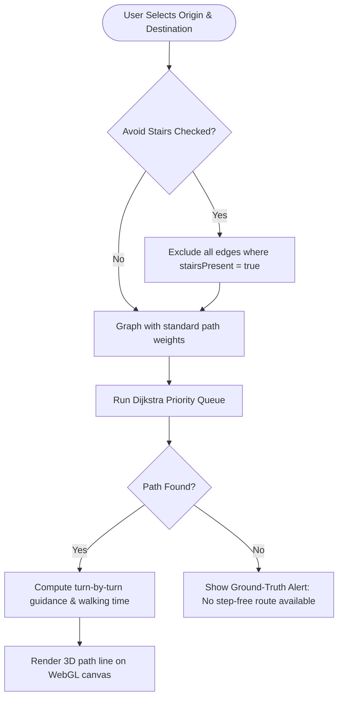

# CampusAble: Accessibility-First 3D Campus Navigation Platform

[](https://react.dev/)
[](https://www.typescriptlang.org/)
[](https://vitejs.dev/)
[](https://threejs.org/)
[](https://tailwindcss.com/)
[](https://vitest.dev/)
[](https://opensource.org/licenses/MIT)

> **Tagline:** *Your Campus. Your Route. Your Independence.*  
> **Initial Reference Campus:** Vidya Academy of Science and Technology (VAST), Thalakkottukara, Thrissur, Kerala, India (PIN: 680501)

---

## 📌 Overview

**CampusAble** is an open-source, accessibility-first 3D web platform engineered to empower students, staff, and visitors—especially wheelchair users and individuals with reduced mobility—to navigate educational campuses safely and independently.

Unlike generic map applications that fail to distinguish between smooth pedestrian paths and steep staircases, CampusAble integrates **ground-truth accessibility audits**, **3D spatial WebGL rendering**, and **graph-based shortest path routing with strict stair avoidance**.

---

## 🌟 Key Features

### 1. 🌐 Interactive 3D Campus Explorer (`/explore`)
- **WebGL 3D Rendering:** Smooth real-time campus navigation powered by Three.js and `@react-three/fiber`.
- **Intuitive Controls:** Orbit, rotate, pan, and zoom around campus blocks with natural touch and mouse interactions.
- **Dynamic Spatial Markers:** Inspect 3D buildings, view certified entrances, ramp access, and step-free clearances.
- **2D Schematic Toggle:** Instant one-click switch between the 3D model and a 2D architectural blueprint layout (`Campus2DView`).
- **Orientation & Legend:** Integrated compass rose indicating True North, paired with a dynamic category legend.

### 2. ♿ Graph-Based Accessible Route Planner (`/navigate`)
- **Dijkstra Pathfinding Engine:** Custom shortest-path algorithm optimized for mobility requirements and accessibility weights.
- **Strict Stair Avoidance:** Segment-level exclusion prevents any path from routing through steps when *Avoid Stairs* is enabled.
- **Ground-Truth Honesty:** If no wheelchair-accessible path exists between two points, CampusAble explicitly alerts the user rather than routing them down inaccessible stairs.
- **Turn-by-Turn Wayfinding:** Precise waypoint instructions, total distance in meters, and estimated travel time tailored to mobility type:
  - *Mobility Device / Wheelchair:* Calibrated at ~50 m/min.
  - *Standard Pedestrian:* Calibrated at ~75 m/min.
- **3D Route Overlay:** Visual glowing path highlights the chosen accessible journey in real-time.

### 3. 🏢 Campus Directory & Search (`/directory`)
- **Instant Search:** Find departments, classrooms, laboratories, auditoriums, canteens, and administrative offices.
- **Accessibility Filtering:** Filter by step-free access, operational passenger lifts, verified ramps, and verification status.
- **Direct Navigation:** Jump straight from search results to 3D visualization or generate a route with one click.

### 4. 🔍 Building Details & Floor Plans (`/building/:id`)
- **Physical Specifications:** Accurate dimensions, 3D coordinates, and audit verification records.
- **Entrance Clearance Audits:** Clear door width measurements (cm), threshold classifications, and ramp gradients.
- **Multi-Level Floor Plans:** Floor-by-floor breakdown of facilities. Empty states clearly communicate when indoor floor data is pending, preventing fabricated layouts.

### 5. ♿ Accessibility Center (`/accessibility`)
- **Facility Directory:** Centralized catalog of campus ramps, passenger elevators, accessible restrooms, and tactile paths.
- **Quick-Route Hand-off:** Tap any certified facility to pre-fill it directly as a destination in the Route Planner.

### 6. 📢 Community Barrier Reporting (`/report`)
- **Crowdsourced Auditing:** Users can report blocked pathways, broken elevators, construction barriers, or missing handrails.
- **Detailed Submissions:** Supports issue category, location description, severity levels (low to critical), and photo attachments.
- **Transparent Local Storage:** Reports are stored locally with clear disclaimers that demo reports remain in-browser until backend submission.

### 7. 🛠️ Administrative Data Hub (`/admin`)
- **Full CRUD Management:** Add, edit, or remove buildings, coordinate anchors (X, Y, Z), and scale dimensions.
- **JSON Import / Export:** Schema-validated export and import routines with relational integrity checks for campus backup and synchronization.
- **Instant Reset:** Restore the baseline reference dataset with a single click.
- **Live 3D Preview:** Visual preview tab reflects dataset modifications instantly before committing.

### 8. 🗺️ AI-Assisted Map Board Ingestion Pipeline
- **Map Photo Upload:** Accepts high-resolution images (PNG, JPG, WebP) of campus master boards.
- **Metadata Tagging:** Captures orientation notes, landmark landmarks, and known building identifiers.
- **Spatial Extraction Readiness:** Formats candidate bounding boxes and spatial footprints with confidence metrics.
- **Human-in-the-Loop Audit:** Mandatory review checklist ensures AI suggestions never enter production without human verification. Zero API keys exposed in client bundles.

---

## 🏗️ Architecture & Technology Stack

```
campusable/
├── public/                 # Static assets, campus map board photos, and SPA redirects
├── src/
│   ├── components/         # Reusable UI & 3D WebGL components
│   │   ├── campus3d/       # Three.js canvas, building meshes, compass, legend
│   │   ├── forms/          # Map import & barrier report forms
│   │   └── layout/         # Header, Navbar, Footer, VerificationBadges
│   ├── data/               # Reference campus baseline data (VAST Thrissur)
│   ├── features/           # Domain feature modules (admin, buildings, navigation, reports)
│   ├── pages/              # Routed view pages (Home, Explore, Navigate, Directory, Admin...)
│   ├── services/           # AI spatial map parsing service & API abstraction
│   ├── styles/             # Tailwind CSS & global styles
│   ├── test/               # Vitest unit & integration test suites
│   ├── types/              # TypeScript interfaces for campus, graph, and routing
│   └── utils/              # Dijkstra engine, local storage layer, schema validators
├── package.json            # Dependencies & build scripts
├── tailwind.config.js      # Accessible, high-contrast theme definitions
├── tsconfig.json           # Strict TypeScript configuration
└── vite.config.ts          # Vite build and development configuration
```

### Core Technologies

| Layer | Technology | Purpose |
| :--- | :--- | :--- |
| **Framework** | [React 18](https://react.dev/) | Component architecture & reactive UI state |
| **Language** | [TypeScript 5.5](https://www.typescriptlang.org/) | Type safety, data validation, and autocompletion |
| **Build Tool** | [Vite 5](https://vitejs.dev/) | Lightning-fast HMR and optimized production bundles |
| **3D Engine** | [Three.js](https://threejs.org/) + [R3F](https://r3f.docs.pmnd.rs/) + [Drei](https://github.com/pmndrs/drei) | Hardware-accelerated WebGL 3D campus visualization |
| **Styling** | [Tailwind CSS 3](https://tailwindcss.com/) | Accessible, high-contrast, mobile-first responsive layout |
| **Routing** | [React Router v6](https://reactrouter.com/) | Client-side routing with deep link support |
| **Icons** | [Lucide React](https://lucide.dev/) | Clean, accessible SVG iconography |
| **Testing** | [Vitest](https://vitest.dev/) | Unit tests for Dijkstra pathfinding and validation |

---

## 🧮 Routing Engine & Verification Taxonomy

### Dijkstra Algorithm with Accessibility Penalties

Campus pathways are modeled as a weighted directed graph $G = (V, E)$:
- **Vertices ($V$):** Campus entrances, building thresholds, intersections, lifts, and ramps.
- **Edges ($E$):** Walkways, corridors, elevators, and stairs.
- **Weights ($W$):** Adjusted dynamically based on user preferences. When `avoidStairs = true`, any edge flagged with `stairsPresent = true` is filtered completely from the traversal queue.



### Four-Tier Verification Taxonomy

Every building, entrance, and route segment carries a verified credibility tier:

| Tier | Status | Criteria | UI Indicator |
| :---: | :--- | :--- | :---: |
| 🟢 | **`verified`** | Physically audited on-site with ground measurements and photo records. | Green Badge |
| 🟡 | **`approximate`** | Derived from official blueprints (e.g., NAAC 4.1.1 Site-Plan) or satellite imagery. | Amber Badge |
| 🔴 | **`unverified`** | Preliminary or crowdsourced submission awaiting physical inspection. | Rose Badge |
| 🟣 | **`demo`** | Demonstration mock data illustrating platform capabilities. | Purple Badge |

---

## 🚀 Getting Started

### Prerequisites

- **Node.js:** v18.0.0 or later (v20+ recommended)
- **npm:** v9.0.0 or later (or pnpm / yarn)

### 1. Clone the Repository

```bash
git clone https://github.com/devika2006-rv/campusable.git
cd campusable
```

### 2. Install Dependencies

```bash
npm install
```

### 3. Run Development Server

```bash
npm run dev
```

Open your browser and navigate to `http://localhost:3000`.

### 4. Run Automated Test Suite

```bash
npm test
```

Executes the Vitest test suite covering:
- Dijkstra shortest path logic
- Strict stair exclusion and route failure honesty
- Campus JSON schema and relational integrity validation

### 5. Production Build & Preview

```bash
# Build production bundle
npm run build

# Preview production build locally
npm run preview
```

The optimized static files will be placed into the `dist/` directory, ready to be hosted on any static hosting provider (Vercel, Netlify, Cloudflare Pages, GitHub Pages).

---

## 🏫 Reference Campus Baseline

The initial calibration dataset models:
- **Institution:** Vidya Academy of Science and Technology (VAST)
- **Location:** Thalakkottukara, Thrissur, Kerala, India — PIN 680501
- **Audited Zones:** Main Academic Block, Decennial Block, Mechanical Lab Block, Central Library, Canteen, North/South Entrances, and Auditorium.
- **Reference Sources:**
  - [Google Maps Location](https://maps.app.goo.gl/DzYSTPM9RViqH8Ph9?g_st=ac)
  - [VAST NAAC Physical Facilities Site-Plan (Criterion 4.1.1)](https://www.vidyaacademy.ac.in/naac/4/4.1/4.1.1/4.1.1.pdf)
  - [Official Campus Virtual Tour](https://www.vidyaacademy.ac.in/campus_tour.php)

---

## 🔒 Security & Privacy

- **Zero Key Leakage:** Client-side bundles contain zero secret API keys.
- **Client Storage Isolation:** All user barrier reports and customized building datasets remain on the user's browser via `localStorage` unless explicitly exported.
- **Human Verification Guardrail:** AI-suggested candidate bounds from campus map photos strictly require human admin verification before merging into the production graph.

---

## 🤝 Contributing

Contributions to make campuses across the world accessible are warmly welcomed!

1. Fork the Project
2. Create your Feature Branch (`git checkout -b feature/AmazingFeature`)
3. Commit your Changes (`git commit -m 'feat: Add AmazingFeature'`)
4. Push to the Branch (`git push origin feature/AmazingFeature`)
5. Open a Pull Request

---

## 📄 License

Distributed under the MIT License. See `LICENSE` for more information.

---

<p align="center">
  Built with ❤️ for accessible, inclusive campus communities.
</p>
